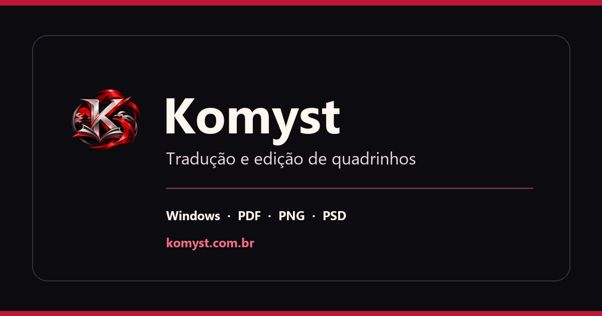

# Komyst

[Official website](https://komyst.com.br/) · [Beta program](https://komyst.com.br/#download) · [Benchmarks](https://komyst.com.br/benchmarks.html) · [Português](README.md)

Komyst is a Windows application for reading, translating, cleaning up, and editing comics. Readers can prepare chapters for PDF or PNG export. Editorial teams can generate cleaned pages and work with layered PSD files, depending on the export profile.

Visual processing runs on your computer. Online translation sends the text needed to process the request. Beta access is rolling out gradually. See the [Privacy Policy](https://komyst.com.br/privacidade.html) for details on data handling.
