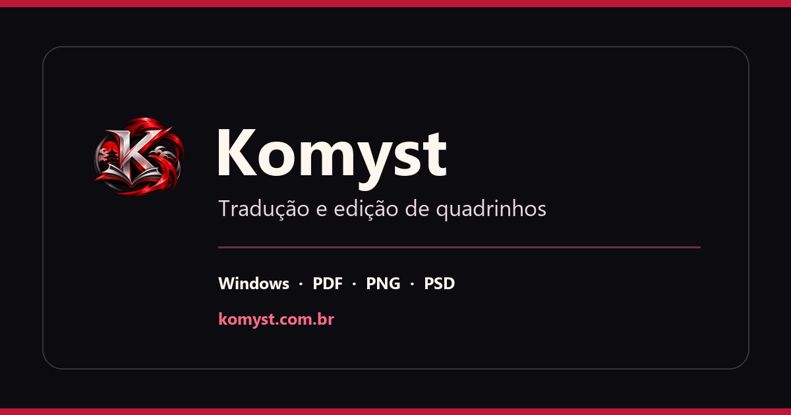

# Komyst

[Site oficial](https://komyst.com.br/) · [Participar do Programa Beta](https://komyst.com.br/#download) · [English](README.en.md)

**Processamento visual, tradução e edição de mangás, manhwas, manhuas e webtoons no Windows.**

O Komyst reconhece texto, limpa regiões da página, reconstrói a arte e aplica traduções em um fluxo que termina em arquivos para leitura ou revisão. O acesso antecipado é liberado gradualmente por convite.

| Para quem | Como usar |
| --- | --- |
| Leitores | Importe páginas locais ou solicite conteúdo de uma fonte compatível. Prepare o capítulo e exporte em PDF ou PNG para ler no computador, celular ou tablet. |
| Scans e editores | Gere páginas limpas, revise as traduções e exporte PSD com arte original, arte limpa e texto em camadas, conforme o perfil. |

- [Demonstração editorial](samples/README.md) e [capturas do aplicativo](docs/getting-started.md#interface).
- [Primeiros passos](docs/getting-started.md), [funcionalidades e idiomas](docs/capabilities.md) e [arquitetura conceitual](docs/architecture.md).
- [Benchmarks internos](docs/benchmarks.md) e [fluxo editorial](docs/editorial-workflow.md).
- [Roadmap](ROADMAP.md), [changelog](CHANGELOG.md), [suporte](SUPPORT.md) e [segurança](SECURITY.md).

Sete rodadas internas processaram 394 páginas lógicas. A menor média observada foi **4,43 s por página**. A metodologia explica o que entrou na contagem e quais dados faltam para comparar as rodadas. Páginas complexas, onomatopeias estilizadas e texto sobre arte podem exigir revisão.

As páginas e a exportação permanecem no dispositivo no fluxo local. A tradução online envia o texto necessário e pode guardar resultados textuais para retomar operações. O modelo usa um crédito YK por capítulo processado, independentemente do número de páginas, respeitados os limites técnicos do aplicativo. [Privacidade](https://komyst.com.br/privacidade.html) · [Preços e créditos](https://komyst.com.br/precos.html).

Este repositório reúne a documentação pública do produto. [Direitos e condições dos materiais](NOTICE.md).
