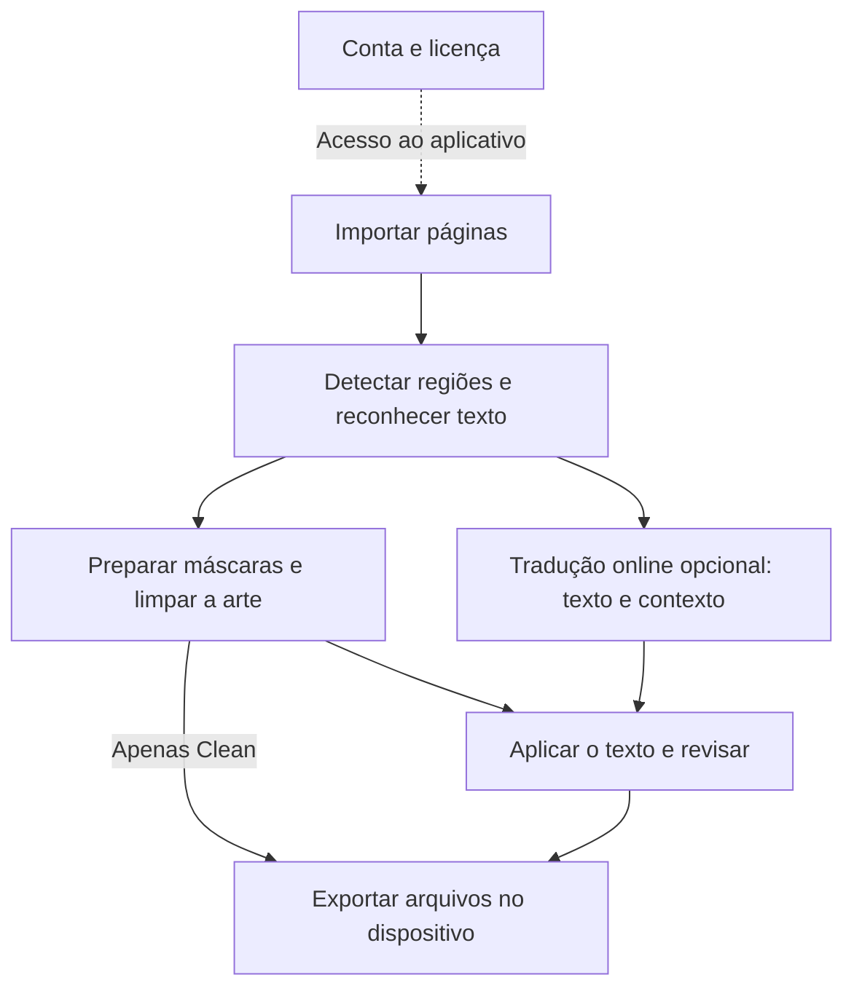

# Arquitetura conceitual

[English](en/architecture.md) · [Início](../README.md)

O processamento visual e a exportação ocorrem no Windows. A tradução online é um fluxo separado que recebe o conteúdo textual necessário. Resultados textuais e informações operacionais podem ser mantidos para retomada e recuperação. Conta e licenciamento têm finalidades próprias. [Política de Privacidade](https://komyst.com.br/privacidade.html).
