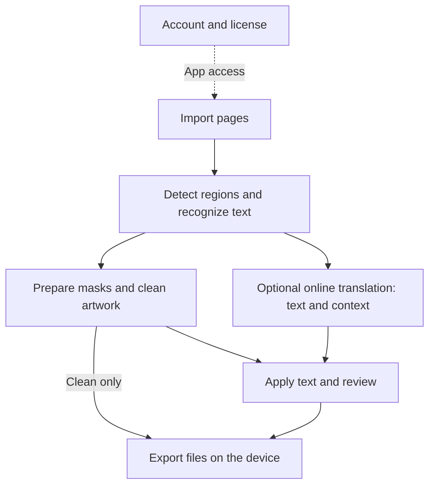

# Conceptual architecture

[Português](../architecture.md) · [Home](../../README.en.md)

Visual processing and export take place on Windows. Online translation is a separate flow that receives the required text. Textual results and operational records may be kept to resume or recover work. Account and licensing services serve separate purposes. [Privacy Policy](https://komyst.com.br/privacidade.html).
