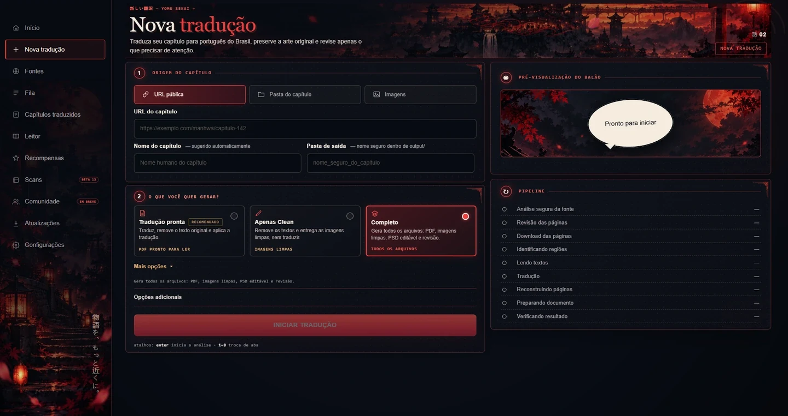
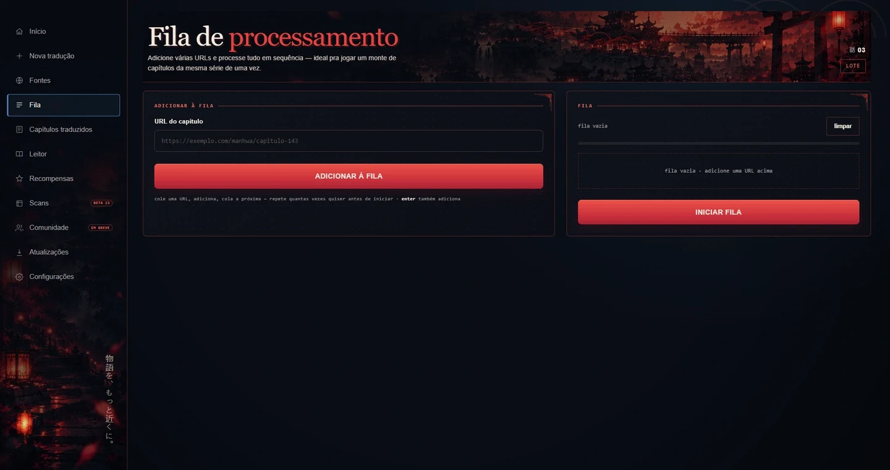

# Getting started

[Português](../getting-started.md) · [Home](../../README.en.md)

1. Join the [Beta waitlist](https://komyst.com.br/#download). The app is available by invitation.
2. After receiving an invitation, follow the official channel's instructions to install and activate the app on Windows.
3. In **New translation**, choose local pages or a compatible source. Use files you are authorized to process.
4. Select an output. **Ready translation** produces a PDF and typeset pages. **Clean only** produces cleaned artwork. **Complete** includes review files and layered PSD output supported by the profile.
5. Check the result before sharing. To read on another device, transfer the exported PDF or PNG files.

The team reports that a beta tester validated a clean Windows installation of `v0.9.1-beta.18`. The test date was not recorded.

## Interface

| New translation | Queue |
| --- | --- |
|  |  |

Both screenshots show the real app. The [editorial workflow](editorial-workflow.md) explains how to review the outputs.
