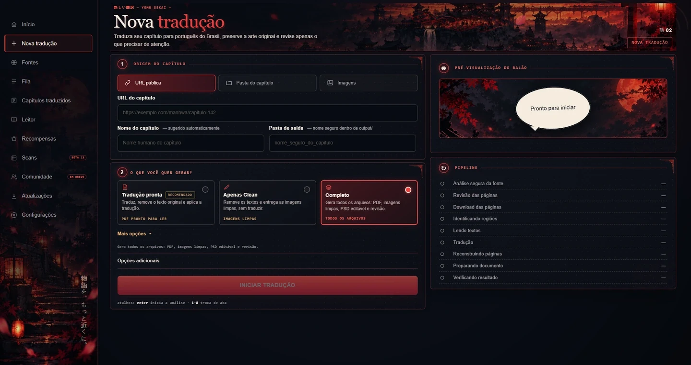
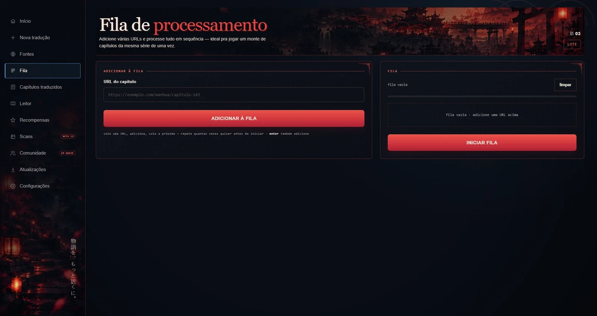

# Primeiros passos

[English](en/getting-started.md) · [Início](../README.md)

1. Entre na [lista do Beta](https://komyst.com.br/#download). O acesso ao aplicativo é liberado por convite.
2. Quando receber o convite, siga as instruções do canal oficial para instalar o aplicativo no Windows e ativar o acesso.
3. Em **Nova tradução**, escolha páginas locais ou uma fonte compatível. Use arquivos que você possa processar.
4. Selecione a saída adequada. **Tradução pronta** entrega PDF e páginas diagramadas. **Apenas Clean** gera arte limpa. **Completo** inclui os materiais de revisão e o PSD em camadas compatíveis com o perfil.
5. Confira o resultado antes de compartilhar. Para leitura em outro dispositivo, transfira o PDF ou os PNGs exportados.

O Beta foi validado em instalação limpa no Windows na versão `v0.9.1-beta.18`, conforme informado pela equipe a partir da verificação de um beta tester. A data da rodada não foi registrada.

## Interface

| Nova tradução | Fila |
| --- | --- |
|  |  |

As duas capturas mostram a interface real. O [fluxo editorial](editorial-workflow.md) explica a revisão dos arquivos de saída.
