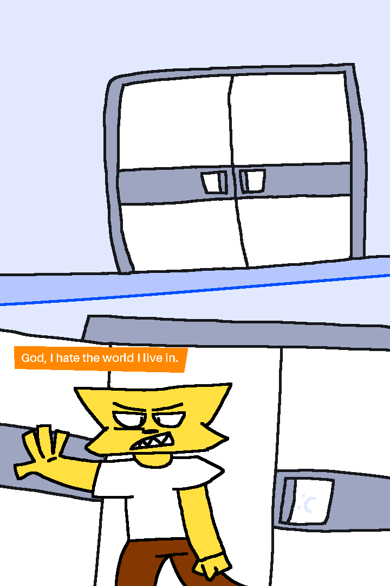
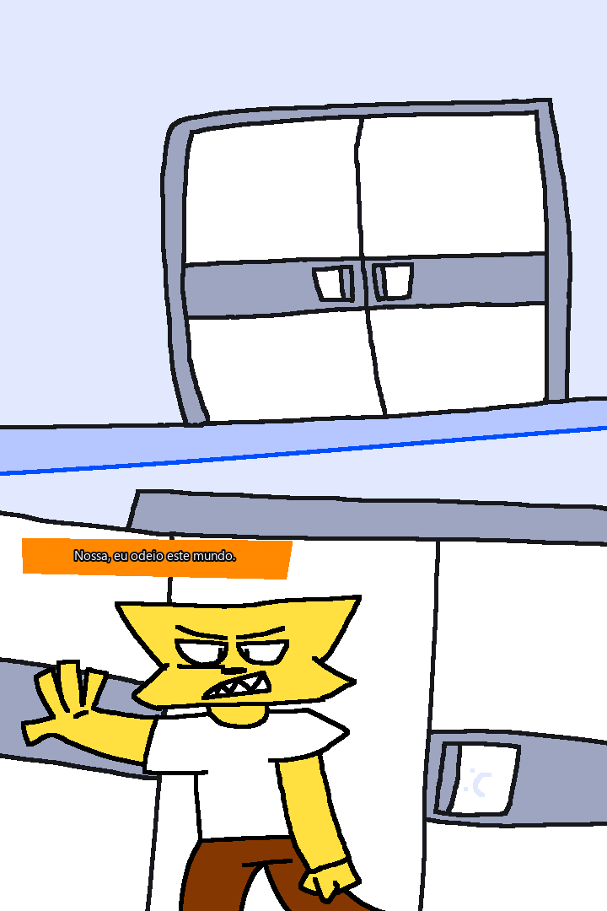

# Demonstração editorial

[English](#english) · [Início](../README.md)

**LUDICRITAL, página 1**, por UptownRascal (blitzdoughnuts). A página original tem uma legenda sobre uma faixa colorida. O teste mostra o preenchimento da faixa e o texto em português colocado na mesma área.

| Original | Arte limpa | Diagramado em PT-BR |
| --- | --- | --- |
|  |  |  |

As três imagens têm 720 × 1080 px e o mesmo enquadramento. O Komyst executou OCR, limpeza, diagramação e exportação. O texto em português foi fornecido offline para o teste. A saída visual foi publicada sem retoques. O certificado de limpeza da página passou na execução. Este caso mede o fluxo visual e a exportação de uma página, com tradução online fora do ensaio.

### PSD da amostra

[Baixar PSD](ludicrital/ludicrital-p01.psd) · 3.402.622 bytes · 720 × 1080 px

- Exportado em 25/11/2026 no build de desenvolvimento baseado na série `v0.9.1-beta.18`.
- Grupos **ORIGINAL** (arte original oculta por padrão), **CLEAN** e **TEXT**. A camada nativa **TEXT_001** foi confirmada por leitura da estrutura do arquivo.
- SHA-256 `6cf25a9aaf0325452abc9aa582c871797aa6118dc2f206b72bea2bb6bd747c2d`.
- A abertura e a edição no Photoshop ainda aguardam homologação para este arquivo.

Arte original dedicada sob CC0 1.0 pelo autor. As mudanças foram limpeza da legenda, diagramação do texto em PT-BR e exportação. As prévias foram codificadas como WebP sem perdas. [Página original](https://ludicrital.neocities.org/pages/1) · [Declaração do autor](https://ludicrital.neocities.org/info) · [CC0 1.0](https://creativecommons.org/publicdomain/zero/1.0/).

## English

**LUDICRITAL, page 1**, by UptownRascal (blitzdoughnuts). The original page uses a caption on a colored strip. The demo shows the strip after cleanup and the Brazilian Portuguese lettering applied to the same area.

The three images above have the same 720 × 1080 px framing. Komyst ran OCR, cleanup, typesetting and export. Brazilian Portuguese text was supplied offline for this test. The visual results are presented without retouching. The page passed the run's cleanup certification. This is a visual and export test on one page. Online translation was outside its scope.

[Download PSD](ludicrital/ludicrital-p01.psd) · 3,402,622 bytes · 720 × 1080 px. Exported on November 25, 2026 using a development build in the `v0.9.1-beta.18` series. It contains **ORIGINAL** (hidden by default), **CLEAN** and **TEXT**. The file structure confirms the native **TEXT_001** layer. See the SHA-256 above. Opening and editing this file in Photoshop have yet to be verified.

The author dedicated the original art under CC0 1.0. Changes cover caption cleanup, Brazilian Portuguese lettering and export. Previews use lossless WebP. [Original page](https://ludicrital.neocities.org/pages/1) · [Author's declaration](https://ludicrital.neocities.org/info) · [CC0 1.0](https://creativecommons.org/publicdomain/zero/1.0/).
